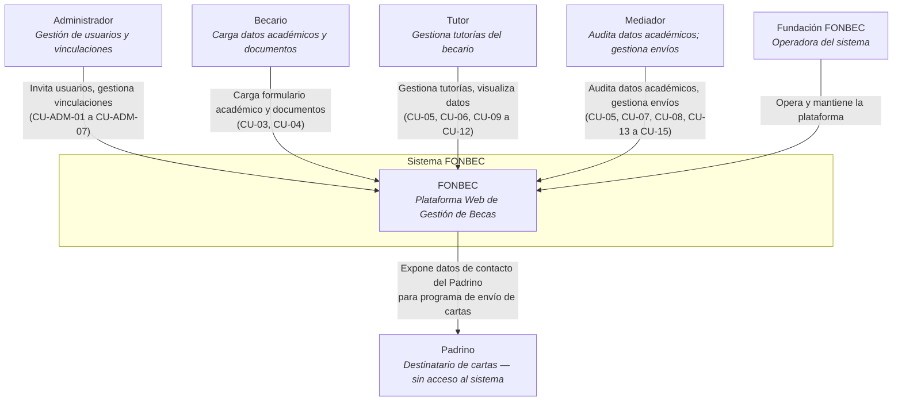
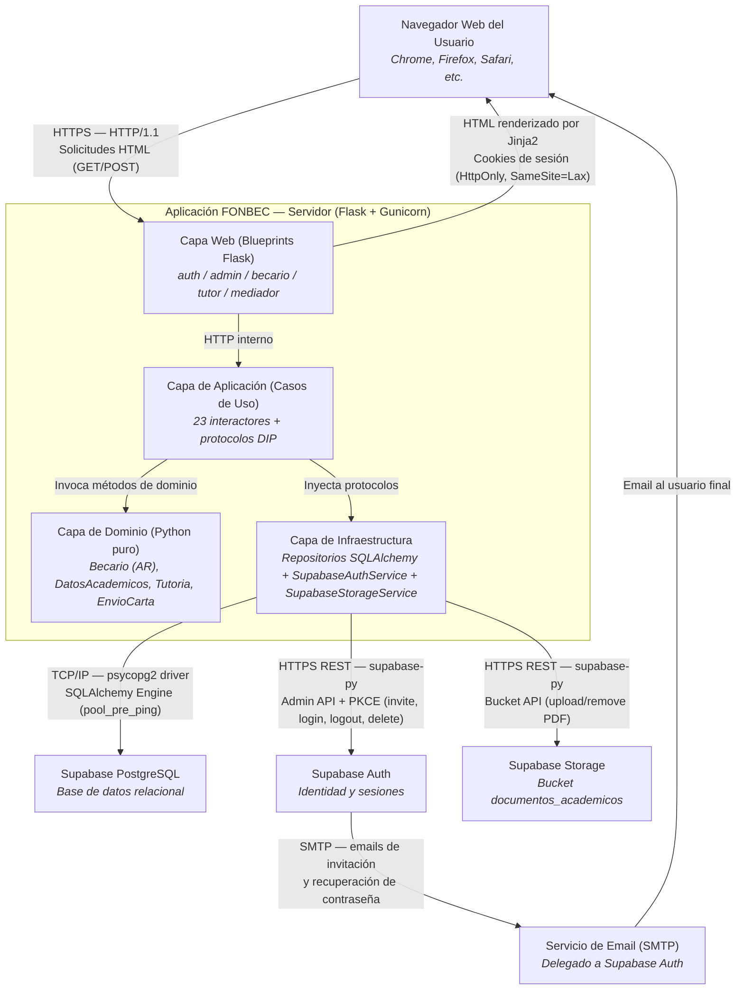

  

# 3. Alcance y Contexto del Sistema

## Descripción General

Esta sección define los límites del sistema FONBEC, identificando sus actores externos, socios de comunicación e interfaces. Se distingue entre el contexto de negocio (interacciones específicas del dominio con usuarios y entidades externas) y el contexto técnico (protocolos de comunicación, canales y servicios de infraestructura en la nube).

---

## 3.1 Contexto de Negocio

El sistema FONBEC interactúa con cinco tipos de actores del dominio y opera como plataforma centralizada de la Fundación FONBEC. Cada actor tiene un conjunto de responsabilidades y flujos de interacción definidos y delimitados por las reglas de negocio del sistema.

- **Administrador**: Gestiona el ciclo de vida de usuarios (invitaciones, eliminaciones) y todas las vinculaciones entre actores del dominio.
- **Becario**: Carga y actualiza su información académica; sube documentación requerida; visualiza su calendario de tutorías.
- **Tutor**: Supervisa a sus becarios asignados; gestiona el calendario de tutorías; visualiza datos académicos sin poder de auditoría.
- **Mediador**: Audita los datos académicos de sus becarios (aprueba o rechaza); gestiona el calendario de envíos de cartas.
- **Padrino**: Entidad de referencia sin acceso al sistema. Es el destinatario de las cartas gestionadas por el Mediador.

### Diagrama de Contexto de Negocio

### Descripción de Actores y Comunicaciones

| Actor / Sistema | Descripción | Interacción con FONBEC |
| :--- | :--- | :--- |
| **Administrador** | Actor de gestión central. Es el único con poder de creación de usuarios y vinculaciones. | Envía formularios de invitación, asignación/desasignación de actores, creación/edición/eliminación de Padrinos. Recibe páginas HTML con listados y perfiles. |
| **Becario** | Usuario invitado que gestiona su propia información académica. | Envía el formulario académico y archivos PDF. Recibe vistas de su estado académico, calendario de tutorías y datos de contacto de su Tutor y Mediador. |
| **Tutor** | Referente responsable de la gestión de tutorías del becario asignado. | Visualiza listado de becarios, selecciona uno y gestiona el calendario de tutorías. Recibe vistas de datos académicos del becario sin capacidad de auditoría. |
| **Mediador** | Referente con potestad de auditoría académica y gestión de envíos de cartas. | Visualiza listado de becarios, selecciona uno y emite decisiones de aprobación/rechazo de datos académicos. Gestiona el calendario de envíos de cartas. |
| **Padrino** | Entidad de referencia sin acceso al sistema. Donante vinculado a uno o más becarios. | Sus datos de contacto son gestionados por el Administrador y expuestos al Mediador y al Becario como referencia para el programa de envío de cartas. No envía ni recibe información al sistema directamente. |
| **Fundación FONBEC** | Organización operadora del sistema. | Define las reglas de negocio y opera la plataforma. No es un actor técnico del sistema; su representación se materializa a través del rol Administrador. |

---

## 3.2 Contexto Técnico

El sistema FONBEC es una aplicación web de renderizado en el servidor (SSR). Toda la lógica de presentación se procesa en el backend mediante Flask y Jinja2; el resultado es HTML que se envía al navegador del usuario. El sistema se apoya en tres servicios externos de Supabase para identidad, persistencia y almacenamiento de archivos.

### Diagrama de Contexto Técnico

### Descripción de Interfaces Técnicas

| Interfaz | Tecnología / Protocolo | Dirección | Descripción |
| :--- | :--- | :--- | :--- |
| **Navegador → Flask** | HTTP/HTTPS, HTML Forms (GET/POST) | Entrada | El usuario interactúa con la aplicación mediante formularios HTML estándar. No se utilizan llamadas AJAX ni APIs JSON en el MVP. |
| **Flask → Navegador** | HTML/CSS/JS generado por Jinja2, Cookies | Salida | El servidor responde con documentos HTML completos. Las cookies de sesión son `HttpOnly` y `SameSite=Lax`, con expiración de 30 minutos. |
| **Infraestructura → Supabase PostgreSQL** | TCP/IP, driver `psycopg2`, SQLAlchemy 2.x | Salida | Conexión directa a la base de datos de Supabase mediante `SUPABASE_DATABASE_URL`. Se emplea `pool_pre_ping=True` para detección de conexiones obsoletas. |
| **Infraestructura → Supabase Auth** | HTTPS REST, biblioteca `supabase-py` | Salida | La capa de infraestructura utiliza la Admin API de Supabase para: invitar usuarios (`invite_user_by_email`), autenticar (`sign_in_with_password`), invalidar sesiones (`sign_out`), y eliminar identidades (`admin.delete_user`). El flujo de callback usa PKCE (`exchange_code_for_session`). |
| **Infraestructura → Supabase Storage** | HTTPS REST, biblioteca `supabase-py` | Salida | Carga y eliminación de archivos PDF en el bucket `documentos_academicos`. La ruta sigue la convención `becarios/{becario_id}/{tipo_documento}_{nombre}.pdf`. Soporta upsert (reemplazo en lugar de duplicado). |
| **Supabase Auth → Email (SMTP)** | SMTP (delegado a Supabase) | Externo | Supabase Auth gestiona el envío de emails de invitación (con enlace de activación) y de recuperación de contraseña. El sistema FONBEC no maneja directamente ningún servidor SMTP. |

---

## Motivación

Comprender el contexto de negocio y técnico del sistema FONBEC es fundamental para identificar todas las dependencias externas, gestionar los riesgos de disponibilidad de terceros (especialmente Supabase como plataforma única de infraestructura cloud) y garantizar que las interfaces hacia los actores humanos sean coherentes con las reglas de acceso y los roles definidos en el dominio.

---

*Sección anterior: [02 — Restricciones de la Arquitectura](./02-restricciones-arquitectura.md)*  
*Sección siguiente: [04 — Estrategia de Solución](./04-estrategia-solucion.md)*
