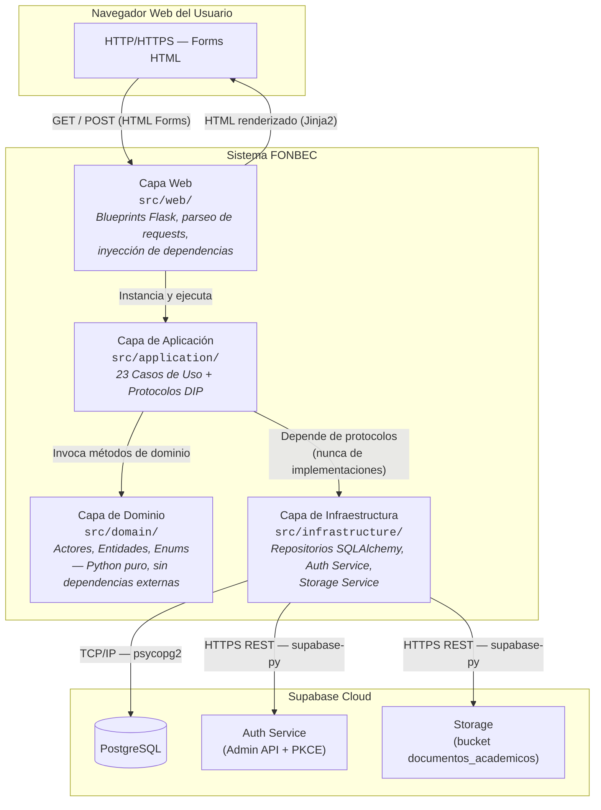
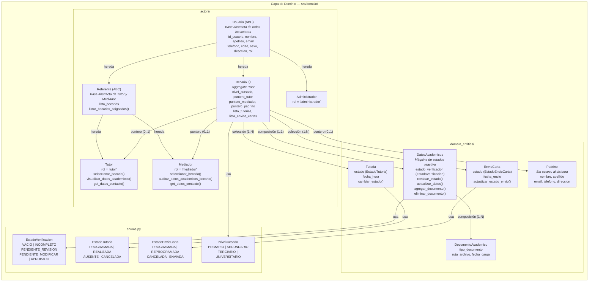
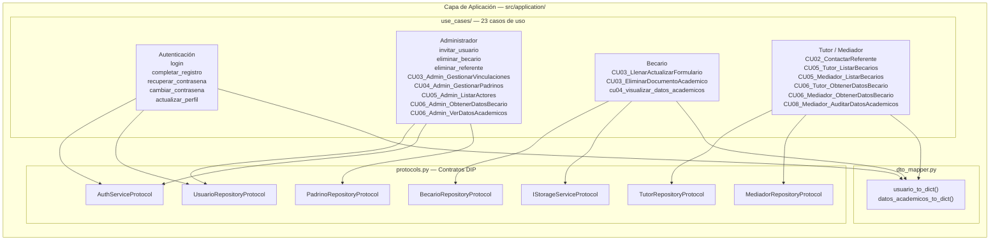
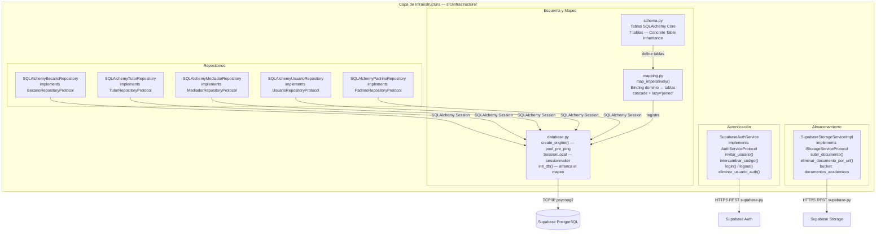
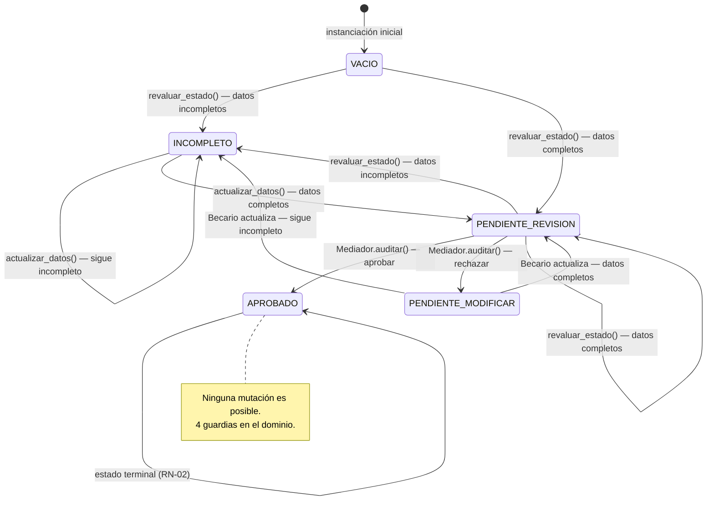

<div align="center">
  
</div>

# 5. Vista de Bloques

Esta sección describe la descomposición estática del sistema FONBEC en bloques de construcción. Se presentan tres niveles de zoom: el sistema completo como caja blanca (Nivel 1), cada capa arquitectónica con sus componentes internos (Nivel 2) y los componentes más complejos con su estructura interna (Nivel 3).

---

## 5.1 Nivel 1 — Sistema General (Caja Blanca)

El sistema FONBEC se descompone en cuatro capas arquitectónicas con dependencias estrictamente unidireccionales. Ninguna capa puede importar artefactos de una capa de mayor jerarquía.

### Diagrama de Nivel 1



### Bloques de construcción del Nivel 1

| Bloque | Responsabilidad | Ubicación |
| :--- | :--- | :--- |
| **Capa Web** | Recibir requests HTTP, parsear formularios, gestionar sesiones, inyectar dependencias y devolver respuestas HTML o redirecciones. | `src/web/` |
| **Capa de Aplicación** | Orquestar los flujos de negocio a través de casos de uso. Depende de protocolos (interfaces) para acceder a infraestructura. No contiene lógica de negocio propia. | `src/application/` |
| **Capa de Dominio** | Contener todas las reglas de negocio del sistema. Entidades puras de Python sin dependencias de framework, ORM ni servicios externos. | `src/domain/` |
| **Capa de Infraestructura** | Implementar los protocolos de la capa de aplicación: acceso a BD, autenticación y almacenamiento de archivos. | `src/infrastructure/` |

---

## 5.2 Nivel 2 — Capa de Dominio (Caja Blanca)

La capa de dominio es el núcleo del sistema. Contiene las reglas de negocio en forma de clases Python puras, organizadas en actores y entidades de dominio.

### Diagrama de Nivel 2 — Dominio



### Descripción de los componentes del Dominio

| Componente | Tipo | Responsabilidad |
| :--- | :--- | :--- |
| `Usuario` | Clase abstracta | Define la identidad base de todos los actores del sistema. Declara `visualizar_datos_academicos()` como método abstracto, garantizando que cada actor concrete su propia vista. |
| `Referente` | Clase abstracta | Extiende `Usuario` con `lista_becarios` y `seleccionar_becario()`. Base compartida de `Tutor` y `Mediador`. |
| `Becario` ⬡ | **Aggregate Root** | Entidad central del modelo. Contiene por composición `DatosAcademicos` y por colección `Tutoria` y `EnvioCarta`. Expone los punteros hacia `Tutor`, `Mediador` y `Padrino`. Toda navegación al resto del agregado pasa por `Becario`. |
| `Tutor` | Clase concreta | Referente responsable de las tutorías. Puede visualizar datos académicos pero no tiene potestad de auditoría. |
| `Mediador` | Clase concreta | Referente con potestad de auditoría académica (CU-08: aprobar/rechazar). Gestiona el calendario de envíos de cartas. |
| `Administrador` | Clase concreta | Actor de gestión global. No hereda de `Referente`; tiene visibilidad sobre todos los actores del sistema. |
| `DatosAcademicos` | Entidad de dominio | Implementa la máquina de estados del proceso de verificación académica. Valida sus propias transiciones y guarda RN-02 en cuatro puntos de control independientes. |
| `DocumentoAcademico` | Entidad de dominio | Representa un archivo PDF adjunto. Tiene `tipo_documento` como clave de identificación dentro del agregado. |
| `Tutoria` | Entidad de dominio | Registro de una sesión de tutoría con su estado y fecha. |
| `EnvioCarta` | Entidad de dominio | Registro de un envío de carta al Padrino con su estado y fecha. |
| `Padrino` | Entidad de dominio | Entidad de referencia sin acceso al sistema. Gestionada íntegramente por el Administrador. |

---

## 5.3 Nivel 2 — Capa de Aplicación (Caja Blanca)

La capa de aplicación orquesta los flujos de negocio. Contiene los casos de uso y los protocolos (interfaces) que desacoplan el dominio de la infraestructura.

### Diagrama de Nivel 2 — Aplicación



---

## 5.4 Nivel 2 — Capa de Infraestructura (Caja Blanca)

La capa de infraestructura implementa los contratos definidos en los protocolos de la capa de aplicación.

### Diagrama de Nivel 2 — Infraestructura



### Descripción del esquema de base de datos (Concrete Table Inheritance)

| Tabla física | Entidad de dominio | Descripción |
| :--- | :--- | :--- |
| `becarios` | `Becario` | Todos los campos de `Usuario` + `nivel_cursado`, `tutor_id`, `mediador_id`, `padrino_id` (FKs). |
| `tutores` | `Tutor` | Campos de `Usuario` + `rol`. |
| `mediadores` | `Mediador` | Campos de `Usuario` + `rol`. |
| `administradores` | `Administrador` | Campos de `Usuario` + `rol`. |
| `padrinos` | `Padrino` | `id_padrino`, `nombre`, `apellido`, `email`, `telefono`, `direccion`. |
| `datos_academicos` | `DatosAcademicos` | FK a `becarios`. `ARRAY(String)` para `materias_a_cursar` y `materias_adeudadas`. `unique=True` en `becario_id` (relación 1:1). |
| `documentos_academicos` | `DocumentoAcademico` | FK a `datos_academicos`. `cascade="all, delete-orphan"`. |
| `tutorias` | `Tutoria` | FK a `becarios`. `cascade="all, delete-orphan"`. |
| `envios_cartas` | `EnvioCarta` | FK a `becarios`. `cascade="all, delete-orphan"`. |

---

## 5.5 Nivel 2 — Capa Web (Caja Blanca)

La capa web expone la interfaz HTTP del sistema mediante Flask Blueprints. Cada Blueprint agrupa las rutas de un actor específico.

### Blueprints registrados

| Blueprint | URL prefix | Rutas clave | Actor |
| :--- | :--- | :--- | :--- |
| `auth_bp` | `/auth` | `/login`, `/logout`, `/callback`, `/set-password`, `/recuperar-contrasena`, `/nueva-contrasena`, `/perfil` | Todos |
| `admin_bp` | `/admin` | `/dashboard`, `/directorio/<rol>`, `/padrinos`, `/padrinos/nuevo`, `/invitar`, `/becarios/<id>/detalle`, `/becarios/<id>/vinculaciones/vincular` | Administrador |
| `becario_bp` | `/becario` | `/dashboard`, `/academico`, `/academico/editar`, `/academico/documento/eliminar` | Becario |
| `tutor_bp` | `/tutor` | `/dashboard`, `/mis-becarios`, `/becario/<id>` | Tutor |
| `mediador_bp` | `/mediador` | `/dashboard`, `/mis-becarios`, `/becario/<id>`, `/becario/<id>/auditoria` | Mediador |

### Middleware de ciclo de vida (app.py)

```
before_request:
    g.db_session = SessionLocal()          ← sesión fresca por request
    g.usuario_actual = cargar_usuario()    ← usuario autenticado desde sesión Flask

teardown_appcontext:
    if sin excepción → db_session.commit()
    if con excepción → db_session.rollback()
    db_session.close()
```

---

## 5.6 Nivel 3 — `DatosAcademicos` (Caja Blanca interna)

`DatosAcademicos` es el componente de mayor complejidad interna del dominio. Implementa una máquina de estados con validación de transiciones y reevaluación reactiva del estado.

### Diagrama de la máquina de estados de `DatosAcademicos`



### Condición de completitud (`validar_completitud()`)

El estado `PENDIENTE_REVISION` solo se alcanza si se cumplen **todas** las condiciones siguientes:

| Condición | Campo |
| :--- | :--- |
| `nombre_carrera` no nulo | Campo texto |
| `anio_ingreso` no nulo | Año válido entre 1900 y el año actual |
| `anio_en_curso` no nulo | Valor entre 1 y 15 |
| `materias_a_cursar` no vacío | Lista con al menos un elemento |
| Documento `Programa` adjunto | `lista_documentos` contiene tipo `"Programa"` |
| Documento `CartaCompromiso` adjunto | `lista_documentos` contiene tipo `"CartaCompromiso"` |
| Documento `Inscripcion` adjunto | `lista_documentos` contiene tipo `"Inscripcion"` |

Si alguna condición no se cumple → estado `INCOMPLETO`.

---

*Sección anterior: [04 — Estrategia de Solución](./04-estrategia-solucion.md)*  
*Sección siguiente: [06 — Vista de Ejecución](./06-vista-de-ejecucion.md)*
