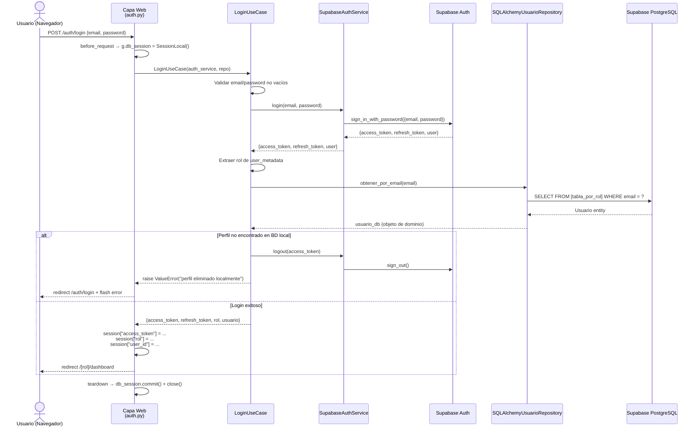
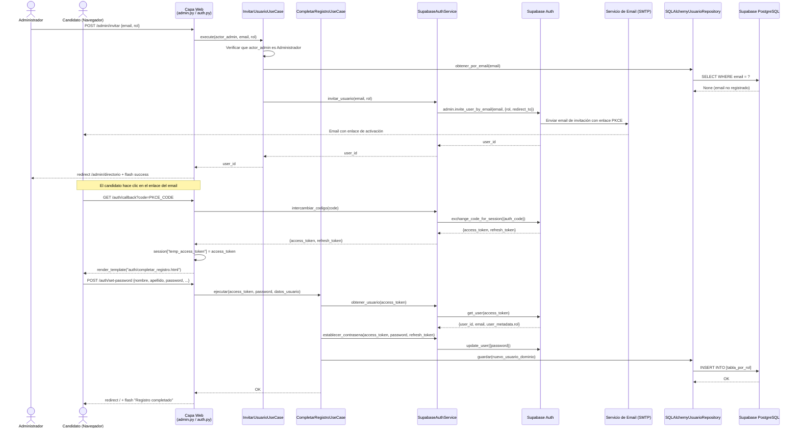
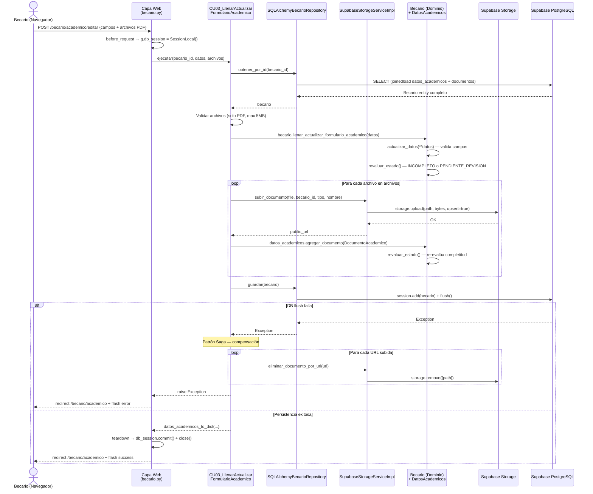
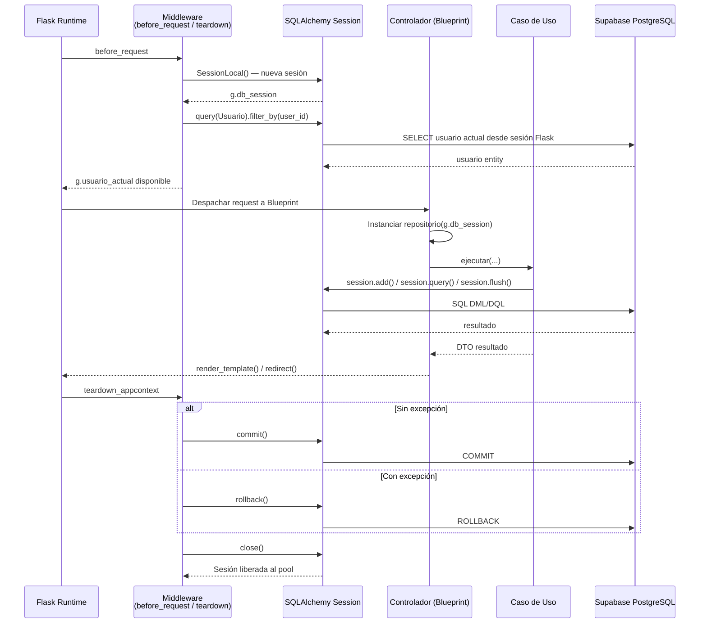

<div align="center">
  
</div>

# 6. Vista de Ejecución

Esta sección documenta los flujos del sistema en tiempo de ejecución a través de los escenarios más representativos. Los diagramas de secuencia muestran cómo interactúan los bloques de construcción (capa web, casos de uso, dominio, infraestructura y servicios externos) durante la ejecución de cada caso de uso.

---

## 6.1 Escenario: Login de Usuario

**Descripción:** Un usuario con cuenta activa inicia sesión con email y contraseña. El sistema valida la identidad contra Supabase Auth y verifica que el perfil local exista en la base de datos antes de establecer la sesión.



**Notas:**
- El rol se obtiene de `user_metadata` de Supabase Auth, no de la base de datos local, para mantener la fuente de verdad de identidad en Supabase.
- Si el perfil no existe en la BD local (cuenta eliminada localmente), se aplica el patrón Saga: se invalida la sesión en Supabase Auth antes de rechazar el login.

---

## 6.2 Escenario: Invitación de Usuario y Completar Registro (PKCE)

**Descripción:** El Administrador invita a un nuevo usuario. El candidato recibe un email con enlace de activación, completa su perfil y establece su contraseña.



---

## 6.3 Escenario: Carga del Formulario Académico con Documentos (Patrón Saga)

**Descripción:** Un Becario actualiza su formulario académico y adjunta uno o más documentos PDF. El sistema aplica el patrón Saga para garantizar que los archivos subidos a Storage sean revertidos si la persistencia en BD falla.



**Notas:**
- El dominio se muta **antes** de subir archivos a Storage. Si la validación de negocio falla (ej. estado `APROBADO`), no se realiza ninguna operación en la nube.
- La compensación Saga es *best-effort*: si el rollback de Storage también falla, el error se silencia para no enmascarar el error original de BD.

---

## 6.4 Escenario: Auditoría de Datos Académicos por el Mediador (CU-08)

**Descripción:** El Mediador aprueba o rechaza los datos académicos de un Becario en estado `PENDIENTE_REVISION`. La máquina de estados del dominio valida la transición antes de persistirla.

```mermaid
sequenceDiagram
    actor Mediador as Mediador (Navegador)
    participant Web as Capa Web<br/>(mediador.py)
    participant UC as AuditarDatosAcademicosUseCase
    participant MedRepo as SQLAlchemyMediadorRepository
    participant Dom as Mediador (Dominio)
    participant BecDom as Becario.DatosAcademicos (Dominio)
    participant DB as Supabase PostgreSQL

    Mediador->>Web: POST /mediador/becario/{id}/auditoria {decision, observaciones}
    Web->>Web: before_request → g.db_session = SessionLocal()
    Web->>UC: execute(id_mediador, id_becario, decision, observaciones)

    UC->>MedRepo: obtener_por_id(id_mediador)
    MedRepo->>DB: SELECT mediador + joinedload(lista_becarios → datos_academicos)
    DB-->>MedRepo: Mediador + Becarios completos
    MedRepo-->>UC: mediador

    UC->>Dom: mediador.seleccionar_becario(id_becario)
    Dom->>Dom: Verificar que id_becario ∈ lista_becarios
    Dom-->>UC: becario (o ValueError "sin permisos")

    alt Rechazar sin observaciones
        UC-->>Web: raise ValueError("observaciones obligatorias al rechazar")
        Web-->>Mediador: redirect + flash error
    end

    UC->>Dom: mediador.auditar_datos_academicos_becario(becario, decision, observaciones)
    Dom->>BecDom: Verificar estado == PENDIENTE_REVISION
    
    alt Aprobar
        Dom->>BecDom: actualizar_estado(APROBADO)
        Dom->>BecDom: observaciones = None; fecha_observacion = None
    else Rechazar
        Dom->>BecDom: actualizar_estado(PENDIENTE_MODIFICAR)
        Dom->>BecDom: observaciones = texto; fecha_observacion = now()
    end

    UC->>MedRepo: guardar(mediador)
    MedRepo->>DB: session.add(mediador) + flush()
    Note over DB: SQLAlchemy cascadea el cambio de estado<br/>en datos_academicos del Becario asociado
    DB-->>MedRepo: OK

    UC-->>Web: datos_academicos_to_dict(becario.datos_academicos)
    Web->>Web: teardown → db_session.commit() + close()
    Web-->>Mediador: redirect /mediador/becario/{id} + flash success
```

**Notas:**
- La autorización de acceso al Becario se realiza **en el dominio** (`mediador.seleccionar_becario()`): si el Becario no está en `lista_becarios` del Mediador, se lanza `ValueError` sin llegar a consultar la BD directamente.
- El cambio de estado en `DatosAcademicos` se propaga a la BD gracias a la relación de cascada configurada en el mapeo imperativo (`cascade="all, delete-orphan"`).

---

## 6.5 Escenario: Ciclo de Vida de la Sesión de Base de Datos (middleware)

**Descripción:** Muestra cómo el middleware de `app.py` gestiona el ciclo de vida de la sesión SQLAlchemy en cada request HTTP.



**Notas:**
- `session.flush()` en los repositorios pre-valida los cambios sin cerrar la transacción. El `commit()` final lo realiza el middleware al cerrar el request.
- Si el controlador lanza una excepción no manejada, `teardown_appcontext` realiza automáticamente el `rollback()`, garantizando la consistencia de la BD.

---

*Sección anterior: [05 — Vista de Bloques](./05-vista-de-bloques.md)*  
*Sección siguiente: [07 — Vista de Despliegue](./07-vista-de-despliegue.md)*
