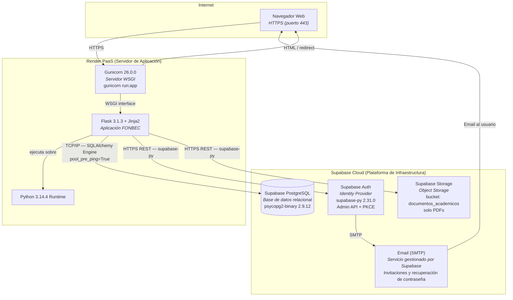
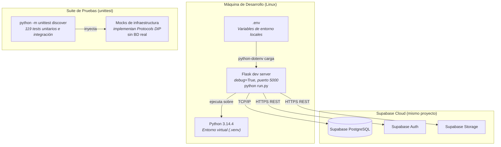

# 7. Vista de Despliegue

Esta sección documenta la infraestructura física y de servicios en la que se ejecuta el sistema FONBEC. Se presentan dos entornos: desarrollo local y producción.

> **Nota:** No existe un `Procfile`, `render.yaml`, `Dockerfile` ni archivo de configuración de servidor en el repositorio. El despliegue en el entorno de producción fue configurado directamente desde el dashboard del proveedor de PaaS (Render). La información documentada en esta sección se extrae de `requirements.txt`, `run.py`, `src/infrastructure/database.py` y de las variables de entorno requeridas por el sistema.

---

## 7.1 Entorno de Producción

### Diagrama de Despliegue — Producción



### Variables de entorno requeridas en producción

| Variable | Descripción | Obligatoria |
| :--- | :--- | :---: |
| `SUPABASE_DATABASE_URL` | URL de conexión PostgreSQL (`postgresql://...`). Si ausente, el sistema falla en el arranque con `sys.exit(1)`. | ✅ Crítica |
| `SUPABASE_URL` | URL del proyecto Supabase (`https://[id].supabase.co`). Requerida para Auth y Storage. | ✅ Crítica |
| `SUPABASE_SERVICE_ROLE_KEY` | Clave de rol de servicio de Supabase. Requerida para la Admin API (invitaciones, eliminación de usuarios). | ✅ Crítica |
| `SUPABASE_ANON_KEY` | Clave anónima de Supabase. Requerida para el cliente de Storage. | ✅ Crítica |
| `SECRET_KEY` | Clave secreta de Flask para firma de cookies de sesión. En dev se usa `dev-secret-key-fonbec-1234` como fallback. | ✅ Crítica |
| `BASE_URL` | URL base pública de la aplicación (`https://[dominio]`). Usada para construir el `redirect_to` de los enlaces de invitación y recuperación de contraseña. | ✅ Crítica |

### Comando de inicio (producción)

```bash
gunicorn run:app
```

- `run` hace referencia al módulo `run.py` en la raíz del proyecto.
- `app` es la instancia Flask creada por `create_app()`.
- No existe un archivo `gunicorn.conf.py`; la configuración de workers, timeout y binding se establece desde el dashboard de Render.

### Stack de producción

| Componente | Versión | Rol |
| :--- | :--- | :--- |
| Python | 3.14.4 | Runtime |
| Flask | 3.1.3 | Framework web + Jinja2 SSR |
| SQLAlchemy | 2.0.50 | ORM imperativo |
| psycopg2-binary | 2.9.12 | Driver PostgreSQL |
| supabase-py | 2.31.0 | Cliente Auth + Storage |
| python-dotenv | 1.2.2 | Carga de variables de entorno desde `.env` |
| gunicorn | 26.0.0 | Servidor WSGI de producción |

---

## 7.2 Entorno de Desarrollo Local

### Diagrama de Despliegue — Desarrollo Local



### Comando de inicio (desarrollo)

```bash
python run.py
# → Flask development server en http://127.0.0.1:5000 (debug=True)
```

### Inicialización de base de datos al arranque

En ambos entornos, al iniciar la aplicación se ejecuta automáticamente `init_db()` desde `src/infrastructure/database.py`:

```
1. iniciar_mapeo()       ← vincula clases de dominio con tablas SQLAlchemy (una sola vez)
2. metadata.create_all() ← crea tablas físicas si no existen (idempotente)
```

---

## 7.3 Limitaciones de Infraestructura Conocidas

| Limitación | Descripción | Impacto |
| :--- | :--- | :--- |
| **Sin archivo de configuración de despliegue versionado** | No existe `Procfile`, `render.yaml` ni `Dockerfile` en el repositorio. La configuración de Gunicorn (workers, timeout) vive en el dashboard de Render, fuera del control de versiones. | Riesgo de reproducibilidad del entorno de producción. |
| **Supabase Free Tier (no confirmado)** | No es posible determinar desde el código si el proyecto está en el plan gratuito de Supabase. El Free Tier impone límites de conexiones concurrentes (máx. 60), tamaño de Storage (1GB) y requests de Auth. | Riesgo de throttling bajo carga. |
| **Un único servidor de aplicación** | No hay evidencia de configuración de múltiples workers, balanceador de carga ni sticky sessions. La sesión Flask se almacena en cookies firmadas (sin sesiones de servidor externas como Redis). | La escalabilidad horizontal está limitada por el estado en cookie. |
| **Sin migraciones versionadas** | La BD se inicializa con `create_all()`. No existe un sistema de migraciones (Alembic, Flyway). Cambios de esquema en producción requieren operaciones manuales. | Riesgo operativo ante cambios de esquema futuros. |

---

*Sección anterior: [06 — Vista de Ejecución](./06-vista-de-ejecucion.md)*  
*Sección siguiente: [08 — Conceptos Transversales](./08-conceptos-transversales.md)*
