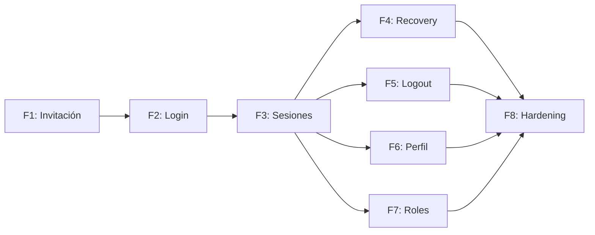

# Roadmap de Implementación de Gestión de Usuarios con Supabase

## Resumen Ejecutivo

### Objetivo General
Reemplazar el sistema de autenticación mock actual (`mock_auth_service.py` + dummy login routes en `app.py`) por una implementación real basada en **Supabase Auth**, manteniendo la arquitectura Clean Architecture existente y el modelo de invitación controlada por el Administrador (RN-ADM-01).

### Estrategia Recomendada
**Supabase Auth como servicio de identidad + Flask session como portador de sesión SSR.** El backend Python usa `supabase-py` (Admin API con `service_role_key`) para operaciones privilegiadas (invitaciones, eliminación) y la API pública para login/logout. Los tokens JWT de Supabase se almacenan en `flask.session` (cookie server-side), NO se exponen al cliente. Esto elimina la necesidad de manejar refresh tokens en el frontend y mantiene el paradigma SSR con `render_template`.

### Módulos Obligatorios para MVP

| Módulo | Prioridad | Motivo |
|--------|-----------|--------|
| Registro por Invitación | P0 | RN-ADM-01: nadie se registra solo |
| Login (email+password) | P0 | Punto de entrada al sistema |
| Gestión de Sesiones | P0 | Sin sesión no hay rutas protegidas |
| Protección de Rutas | P0 | Reemplaza `requiere_rol()` actual |
| Logout | P0 | Cierre de sesión seguro |
| Roles y Permisos | P0 | Cada actor ve solo su dashboard |
| Recuperación de Contraseña | P1 | Necesario antes de producción |
| Gestión de Perfil | P1 | Completar datos post-invitación |

### Módulos Opcionales

| Módulo | Cuándo Implementarlo |
|--------|---------------------|
| Verificación de correo | Post-MVP (Supabase lo maneja por defecto en invitaciones) |
| MFA/2FA | Post-MVP, si se requiere seguridad adicional |
| Audit Log de accesos | Post-MVP, para compliance |
| Renovación automática de tokens | Post-MVP (sesión Flask lo abstrae) |

> [!IMPORTANT]
> **Alerta de Seguridad**: Las 9 tablas públicas tienen RLS DESHABILITADO. Esto DEBE resolverse en la Fase 8 (Hardening) como requisito bloqueante antes de producción.

---

# Arquitectura Recomendada

## Dominio

- **Entidades existentes**: `Usuario` (abstracta), `Becario`, `Tutor`, `Mediador`, `Administrador`, `Padrino` — ya implementadas, no se modifican.
- **Value Objects nuevos**: Ninguno necesario para MVP (el email como identificador ya es un string en `Usuario`).
- **Reglas de negocio**: `login()`/`logout()` en `Usuario` ya lanzan `NotImplementedError` delegando a infraestructura — correcto por diseño.
- **Contratos nuevos**: `AuthServiceProtocol` en `application/protocols.py`.

> [!NOTE]
> El dominio NO cambia. La autenticación es responsabilidad de infraestructura. Los métodos `login()`/`logout()` de `Usuario` mantienen su `NotImplementedError` como documentación del contrato — la implementación real vive en `infrastructure/`.

## Aplicación

- **Casos de uso nuevos**: `LoginUseCase`, `InvitarUsuarioUseCase`, `LogoutUseCase`, `RecuperarContrasenaUseCase`, `CompletarPerfilUseCase`.
- **Protocolo**: `AuthServiceProtocol` define el contrato que infraestructura implementa.
- **Orquestación**: Cada use case recibe el protocolo por inyección, ejecuta validaciones de negocio, y delega la operación de auth.

## Infraestructura

- **Servicio nuevo**: `SupabaseAuthService` implementa `AuthServiceProtocol` usando `supabase-py`.
- **Configuración**: `SUPABASE_SERVICE_ROLE_KEY` (nueva env var) para operaciones admin.
- **Cliente**: Instancia de `supabase.Client` configurada en `database.py` o módulo dedicado.

## Presentación

- **Templates nuevos**: `login.html` (real), `recuperar_contrasena.html`, `nueva_contrasena.html`, `completar_perfil.html`.
- **Decorador**: `requiere_rol()` refactorizado para validar contra `flask.session` + Supabase JWT.
- **Eliminación**: `mock_auth_service.py` y dummy login routes en `app.py`.

---

# FASE 1: Registro de Usuarios por Invitación

## Objetivo
Permitir al Administrador invitar usuarios al sistema con rol predefinido (CU-ADM-01). El candidato recibe un email, establece su contraseña, y queda registrado con su rol asignado.

## Capas Involucradas
- **Aplicación**: `InvitarUsuarioUseCase`
- **Infraestructura**: `SupabaseAuthService.invitar_usuario()`
- **Presentación**: Formulario de invitación en panel admin + ruta callback

## Funcionalidades Requeridas
- Formulario admin: email + selector de rol
- Validación de email no duplicado
- Envío de invitación vía Supabase Auth Admin API
- Página de callback donde el invitado establece su contraseña
- Creación automática del registro en la tabla de rol correspondiente (becarios, tutores, etc.)

## Integraciones con Supabase

**API utilizada**: `supabase.auth.admin.invite_user_by_email(email, options={"data": {"rol": rol}})`

**Flujo interno de Supabase**:
1. Admin API genera un token de invitación y lo envía por email
2. El candidato hace click → llega a la URL de redirect configurada
3. La app intercambia el token → el usuario establece su contraseña
4. `auth.users` guarda el usuario con `user_metadata.rol`

**Configuración requerida**:
- Habilitar invitaciones en Supabase Dashboard → Auth → Settings
- Configurar Site URL y Redirect URLs
- Agregar `SUPABASE_SERVICE_ROLE_KEY` al `.env`
- Personalizar email template de invitación

**Limitaciones**:
- Rate limit: ~4 emails/hora con SMTP built-in de Supabase (configurar SMTP custom para producción)
- El `user_metadata` es editable por el usuario — el rol DEBE verificarse contra la tabla de dominio, no contra metadata

## Componentes a Implementar

### Aplicación
```
src/application/protocols.py  → agregar AuthServiceProtocol
src/application/use_cases/invitar_usuario.py  → [NEW]
```

**AuthServiceProtocol** (adición a protocols.py):
```python
class AuthServiceProtocol(Protocol):
    def invitar_usuario(self, email: str, rol: str) -> str: ...
    def login(self, email: str, password: str) -> dict: ...
    def logout(self, access_token: str) -> None: ...
    def recuperar_contrasena(self, email: str) -> None: ...
    def obtener_usuario(self, access_token: str) -> Optional[dict]: ...
```

### Infraestructura
```
src/infrastructure/auth_service.py  → [NEW] SupabaseAuthService
```

### Presentación
```
src/web/routes/admin.py  → agregar ruta POST /admin/invitar
src/templates/admin/invitar_usuario.html  → [NEW]
src/web/routes/auth.py  → [NEW] Blueprint para callback de invitación
src/templates/completar_registro.html  → [NEW]
```

## Pasos de Implementación
1. Agregar `SUPABASE_SERVICE_ROLE_KEY` al `.env`
2. Definir `AuthServiceProtocol` en `protocols.py`
3. Implementar `SupabaseAuthService` con `invite_user_by_email`
4. Crear `InvitarUsuarioUseCase` (valida rol, delega a auth service)
5. Crear ruta y template de invitación en admin
6. Crear Blueprint `auth_bp` con ruta `/auth/callback` para completar registro
7. Implementar lógica de callback: intercambiar token → crear registro en tabla de dominio
8. Configurar Redirect URL en Supabase Dashboard

## Riesgos
- **Sincronización auth.users ↔ tablas de dominio**: Si la invitación se acepta pero falla la inserción en la tabla de dominio, queda un usuario en `auth.users` sin registro en `public`. Mitigación: Saga rudimentaria (AGENTS.md §5.6).
- **SMTP rate limits**: Para testing, usar Mailtrap o similar.

## Criterios de Finalización
- Admin puede enviar invitación con rol predefinido
- Candidato recibe email y puede establecer contraseña
- Se crea registro en la tabla de dominio correspondiente
- Email duplicado es rechazado con mensaje claro

---

# FASE 2: Login

## Objetivo
Permitir que usuarios previamente registrados accedan al sistema con email y contraseña.

## Capas Involucradas
- **Aplicación**: `LoginUseCase`
- **Infraestructura**: `SupabaseAuthService.login()`
- **Presentación**: Template `login.html` real + ruta POST

## Funcionalidades Requeridas
- Formulario de login (email + password)
- Validación de credenciales vía Supabase Auth
- Almacenamiento de sesión en `flask.session`
- Redirección según rol al dashboard correspondiente
- Manejo de errores (credenciales inválidas, cuenta desactivada)

## Integraciones con Supabase

**API**: `supabase.auth.sign_in_with_password({"email": email, "password": password})`

**Respuesta exitosa**: Devuelve `access_token`, `refresh_token`, y objeto `user` con `user_metadata`.

**Flujo**:
1. Flask recibe POST con email/password
2. `LoginUseCase` delega a `SupabaseAuthService.login()`
3. Supabase valida credenciales contra `auth.users`
4. Si OK → se almacena `access_token` + `user_id` + `rol` en `flask.session`
5. Se redirige al dashboard según rol

## Componentes a Implementar

### Aplicación
```
src/application/use_cases/login.py  → [NEW]
```

### Infraestructura
```
src/infrastructure/auth_service.py  → agregar método login()
```

### Presentación
```
src/web/routes/auth.py  → agregar ruta POST /auth/login
src/templates/login.html  → [MODIFY] reemplazar dummy por formulario real
```

## Pasos de Implementación
1. Implementar `login()` en `SupabaseAuthService`
2. Crear `LoginUseCase` (valida inputs, delega a auth, consulta tabla de dominio para confirmar rol)
3. Crear ruta `POST /auth/login` en `auth_bp`
4. Reemplazar `login.html` con formulario real
5. Implementar flash messages para errores
6. Eliminar rutas dummy `/login/<user_id>/<rol>` de `app.py`

## Riesgos
- **Usuario en auth.users sin registro en tabla de dominio**: Login exitoso en Supabase pero `404` en la tabla. Mitigación: verificar existencia en tabla de dominio antes de crear sesión.

## Criterios de Finalización
- Usuario puede autenticarse con email y password
- Se genera una sesión válida en `flask.session`
- Se redirige correctamente al dashboard según rol
- Credenciales inválidas muestran error claro
- Rutas dummy de login eliminadas

---

# FASE 3: Gestión de Sesiones + Protección de Rutas

## Objetivo
Reemplazar `mock_auth_service.py` por un sistema de sesión real basado en `flask.session` + tokens de Supabase.

## Capas Involucradas
- **Presentación**: Refactorización de `auth_utils.py` y `mock_auth_service.py`

## Funcionalidades Requeridas
- Almacenar `access_token`, `user_id`, `rol` en sesión Flask (cookie segura server-side)
- Refactorizar `requiere_rol()` para leer de `flask.session` en vez de mock
- Validar que el token no haya expirado (opcional: verificar contra Supabase)
- Inyectar `g.usuario_actual` desde la tabla de dominio usando `session["user_id"]`

## Componentes a Implementar

### Presentación
```
src/web/auth_utils.py  → [MODIFY] refactorizar requiere_rol()
src/web/mock_auth_service.py  → [DELETE]
src/web/app.py  → [MODIFY] eliminar rutas dummy, configurar session cookie
```

## Pasos de Implementación
1. Configurar `SECRET_KEY` seguro (no el default de dev)
2. Configurar cookie session: `SESSION_COOKIE_HTTPONLY=True`, `SESSION_COOKIE_SAMESITE='Lax'`
3. Refactorizar `obtener_usuario_actual()` → leer de `flask.session`
4. Refactorizar `requiere_rol()` → validar sesión real
5. Eliminar `mock_auth_service.py`
6. Eliminar rutas dummy de `app.py` (líneas 66-105)
7. Verificar que todas las rutas existentes funcionan con el nuevo auth

## Criterios de Finalización
- `mock_auth_service.py` eliminado
- Rutas dummy eliminadas de `app.py`
- `requiere_rol()` valida contra sesión real
- Rutas protegidas redirigen a login si no hay sesión
- `g.usuario_actual` se inyecta correctamente desde BD

---

# FASE 4: Recuperación de Contraseña

## Objetivo
Permitir a usuarios recuperar acceso si olvidan su contraseña.

## Integraciones con Supabase
- **Solicitar reset**: `supabase.auth.reset_password_email(email)`
- **Actualizar password**: `supabase.auth.update_user({"password": new_password})`

**Flujo**:
1. Usuario ingresa email → Supabase envía email con link de recovery
2. Click en link → redirect a `/auth/nueva-contrasena?token_hash=...&type=recovery`
3. App verifica token → muestra formulario de nueva contraseña
4. Submit → `update_user` con nueva contraseña

## Componentes a Implementar

### Aplicación
```
src/application/use_cases/recuperar_contrasena.py  → [NEW]
```

### Infraestructura
```
src/infrastructure/auth_service.py  → agregar recuperar_contrasena(), cambiar_contrasena()
```

### Presentación
```
src/web/routes/auth.py  → agregar rutas GET/POST
src/templates/recuperar_contrasena.html  → [NEW]
src/templates/nueva_contrasena.html  → [NEW]
```

## Criterios de Finalización
- Usuario puede solicitar recuperación por email
- Link de recuperación funciona correctamente
- Nueva contraseña se establece y usuario puede hacer login

---

# FASE 5: Logout

## Objetivo
Cerrar sesión del usuario de forma segura, invalidando tanto la sesión Flask como el token de Supabase.

## Componentes a Implementar

### Presentación
```
src/web/routes/auth.py  → agregar ruta /auth/logout
src/web/app.py  → [MODIFY] eliminar ruta /logout dummy
```

**Implementación**:
```python
@auth_bp.route("/logout")
def logout():
    access_token = session.get("access_token")
    if access_token:
        auth_service.logout(access_token)  # Invalida en Supabase
    session.clear()  # Limpia cookie Flask
    return redirect(url_for("auth.login"))
```

## Criterios de Finalización
- Sesión Flask se limpia completamente
- Token se invalida en Supabase
- Redirección a login post-logout

---

# FASE 6: Gestión de Perfil

## Objetivo
Permitir a usuarios actualizar sus datos personales (CU-03 de Usuario base).

## Funcionalidades Requeridas
- Visualizar datos actuales del perfil
- Editar: nombre, apellido, telefono, direccion, edad, sexo
- Cambiar contraseña (requiere contraseña actual)

> [!NOTE]
> El email NO es editable en MVP — es el identificador de auth. Cambio de email es complejidad innecesaria para MVP.

## Componentes a Implementar

### Aplicación
```
src/application/use_cases/actualizar_perfil.py  → [NEW]
```

### Presentación
```
src/web/routes/auth.py  → agregar rutas GET/POST /perfil
src/templates/perfil.html  → [NEW]
```

## Criterios de Finalización
- Usuario puede ver y editar sus datos personales
- Cambios se persisten en la tabla de dominio correspondiente
- Cambio de contraseña funciona (valida password actual)

---

# FASE 7: Roles y Permisos

## Objetivo
Formalizar el sistema de roles que ya existe implícitamente en las tablas de dominio.

## Diseño

**Estrategia**: El rol se determina por la TABLA donde existe el `id_usuario`, no por un campo string. Esto ya es el comportamiento actual del sistema.

**Flujo de resolución de rol**:
1. Login exitoso → se obtiene `user.id` de Supabase
2. Se busca en: `administradores` → `becarios` → `tutores` → `mediadores`
3. La primera tabla donde se encuentre determina el rol
4. Se almacena en `session["rol"]`

**El decorador `requiere_rol()` ya implementa esta lógica** — solo necesita adaptarse para leer de sesión en vez de mock.

> [!IMPORTANT]
> No se necesita una tabla de roles separada. La arquitectura Concrete Table Inheritance ya actúa como sistema de roles. Agregar una tabla `roles` sería sobreingeniería innecesaria.

## Criterios de Finalización
- Cada rol accede solo a su blueprint (`admin_bp`, `becario_bp`, `tutor_bp`)
- Intento de acceso a ruta de otro rol → 403
- Rol se resuelve desde tabla de dominio, no desde metadata de Supabase

---

# FASE 8: Hardening para MVP

## Objetivo
Asegurar el sistema antes de la puesta en producción.

## Funcionalidades Requeridas

### Seguridad
- **Habilitar RLS** en las 9 tablas públicas con políticas adecuadas
- Configurar `SECRET_KEY` robusto (no el default)
- `SESSION_COOKIE_SECURE=True` en producción
- `SESSION_COOKIE_HTTPONLY=True`
- CSRF protection en formularios (Flask-WTF o token manual)
- Rate limiting en login (Flask-Limiter)

### Configuración Supabase
- Configurar SMTP custom (eliminar dependencia del built-in)
- Personalizar email templates (invitación, recovery)
- Configurar Site URL y Redirect URLs correctamente
- Revisar JWT expiry (default 3600s es razonable)

### Limpieza de código
- Eliminar `mock_auth_service.py`
- Eliminar rutas dummy de `app.py`
- Eliminar `password_hash` de las tablas de dominio (Supabase Auth lo maneja)
- Actualizar `observaciones.md`

## Criterios de Finalización
- RLS habilitado con políticas en todas las tablas
- No existe código mock en el repositorio
- Cookies configuradas de forma segura
- SMTP custom configurado
- Email templates personalizados

---

# Dependencias Entre Fases

| Fase | Depende de |
|------|------------|
| F1: Invitación | Nada (primera fase) |
| F2: Login | F1 (necesita usuarios registrados) |
| F3: Sesiones | F2 (necesita login funcional) |
| F4: Recovery | F3 (necesita sesiones para cambiar password) |
| F5: Logout | F3 (necesita sesiones para cerrarlas) |
| F6: Perfil | F3 (necesita sesiones + resolución de usuario) |
| F7: Roles | F3 (necesita sesiones con rol) |
| F8: Hardening | F1-F7 (cierre de todo) |

> [!TIP]
> **Fases F4, F5, F6, F7 pueden ejecutarse en paralelo** una vez que F3 está completa. F8 es secuencial al final.



---

# Riesgos Técnicos Detectados

| Riesgo | Impacto | Mitigación |
|--------|---------|------------|
| RLS deshabilitado en 9 tablas | **CRÍTICO** — datos expuestos vía anon key | F8: habilitar RLS con políticas |
| Sincronización `auth.users` ↔ tablas de dominio | ALTO — usuarios fantasma | Saga: rollback en auth si falla insert en dominio |
| `password_hash` duplicado en tablas de dominio | MEDIO — inconsistencia con Supabase Auth | F8: eliminar columna (Supabase maneja passwords) |
| SMTP rate limit (4/hora built-in) | MEDIO — bloquea invitaciones en batch | Configurar SMTP custom (SendGrid, Resend, etc.) |
| `id_usuario` es `String` pero `auth.users.id` es `UUID` | MEDIO — type mismatch | Usar UUID string representation, validar formato |
| Cookie `SECRET_KEY` con valor default | ALTO — sesiones predecibles | Generar key seguro en producción |

---

# Archivos Afectados (Resumen)

### Nuevos
| Archivo | Fase |
|---------|------|
| `src/infrastructure/auth_service.py` | F1 |
| `src/application/use_cases/invitar_usuario.py` | F1 |
| `src/application/use_cases/login.py` | F2 |
| `src/application/use_cases/recuperar_contrasena.py` | F4 |
| `src/application/use_cases/actualizar_perfil.py` | F6 |
| `src/web/routes/auth.py` | F1-F5 |
| `src/templates/completar_registro.html` | F1 |
| `src/templates/recuperar_contrasena.html` | F4 |
| `src/templates/nueva_contrasena.html` | F4 |
| `src/templates/perfil.html` | F6 |

### Modificados
| Archivo | Fase | Cambio |
|---------|------|--------|
| `src/application/protocols.py` | F1 | Agregar `AuthServiceProtocol` |
| `src/web/auth_utils.py` | F3 | Refactorizar `requiere_rol()` |
| `src/web/app.py` | F2-F3 | Eliminar rutas dummy, registrar `auth_bp` |
| `src/templates/login.html` | F2 | Reemplazar con formulario real |
| `.env` | F1 | Agregar `SUPABASE_SERVICE_ROLE_KEY` |
| `requirements.txt` | F8 | Agregar `Flask-WTF`, `Flask-Limiter` (opcional) |

### Eliminados
| Archivo | Fase |
|---------|------|
| `src/web/mock_auth_service.py` | F3 |

---

# Checklist Final MVP

| Funcionalidad | Estado Esperado |
|---------------|----------------|
| Registro por invitación (CU-ADM-01) | Completo |
| Login con email+password | Completo |
| Logout seguro | Completo |
| Sesiones Flask + JWT Supabase | Completo |
| Recuperación de contraseña | Completo |
| Perfil editable | Completo |
| Roles por tabla de dominio | Completo |
| Protección de rutas (`requiere_rol`) | Completo |
| RLS habilitado | Completo |
| Mock auth eliminado | Completo |

---

# Verificación Interna

1. ✅ Todos los módulos necesarios para gestión completa de usuarios identificados
2. ✅ Cada módulo asignado a las capas correctas (Dominio intocado, Auth en Infra)
3. ✅ Integraciones de Supabase coherentes con Clean Architecture (detrás de Protocol)
4. ✅ Roadmap optimizado para MVP (8 fases incrementales)
5. ✅ Sin sobreingeniería (no hay tabla de roles, no hay refresh token manual, no hay API JSON)
6. ✅ Dependencias entre fases correctas (F1→F2→F3→[F4,F5,F6,F7]→F8)

> La verificación interna confirma que el roadmap de implementación de gestión de usuarios con Supabase fue diseñado para alcanzar el MVP de forma incremental, manteniendo una arquitectura limpia, escalable y sin sobreingeniería innecesaria.
